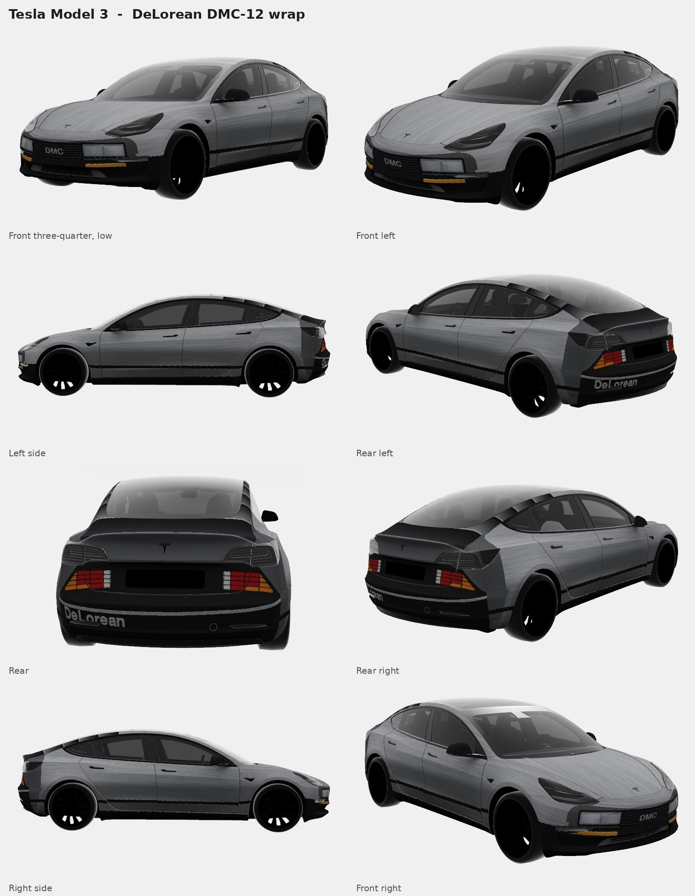
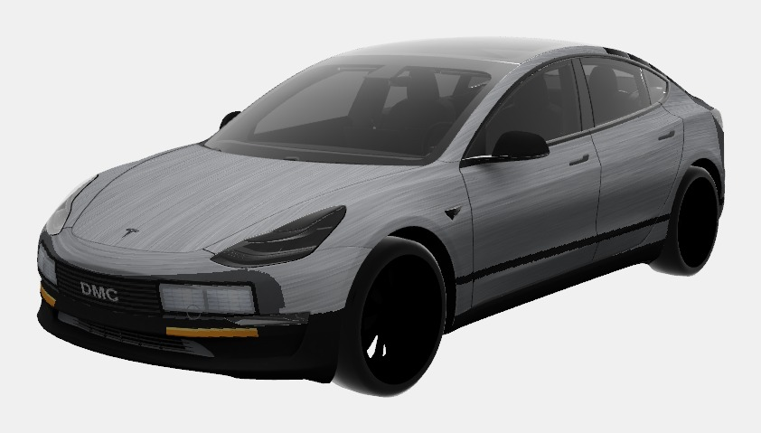
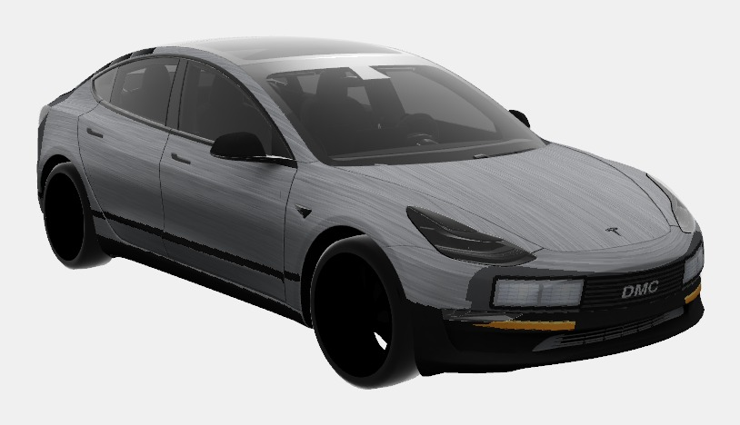
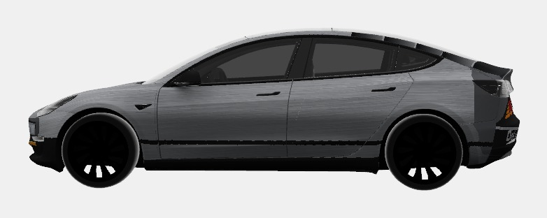
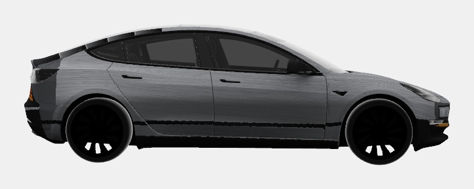
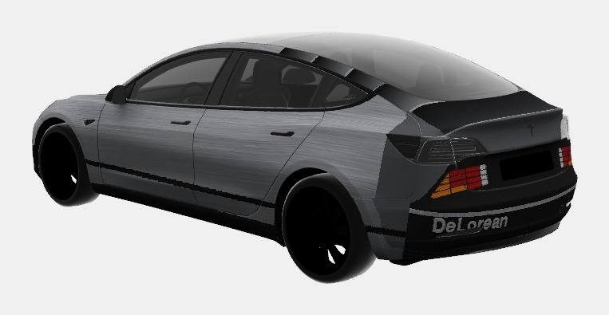
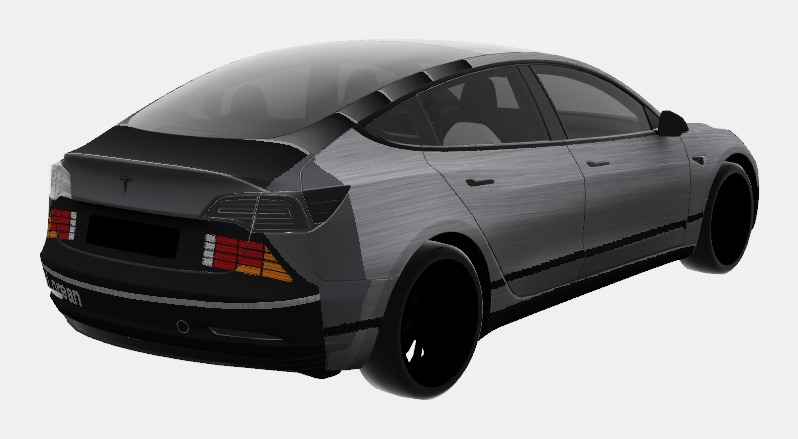
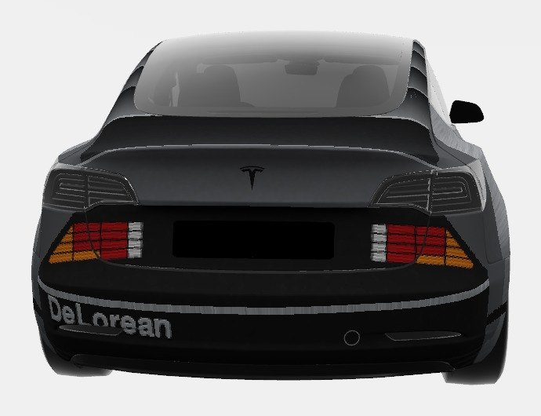
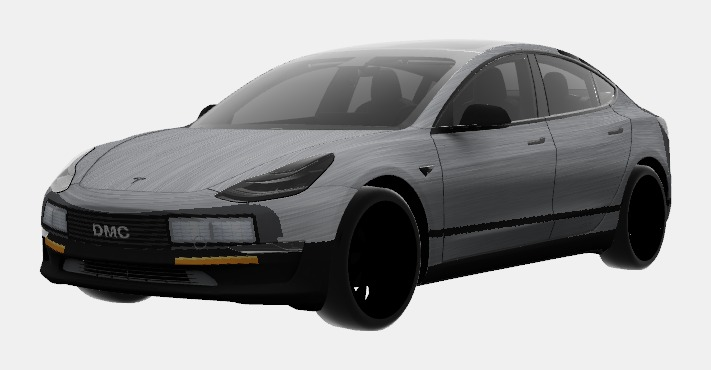
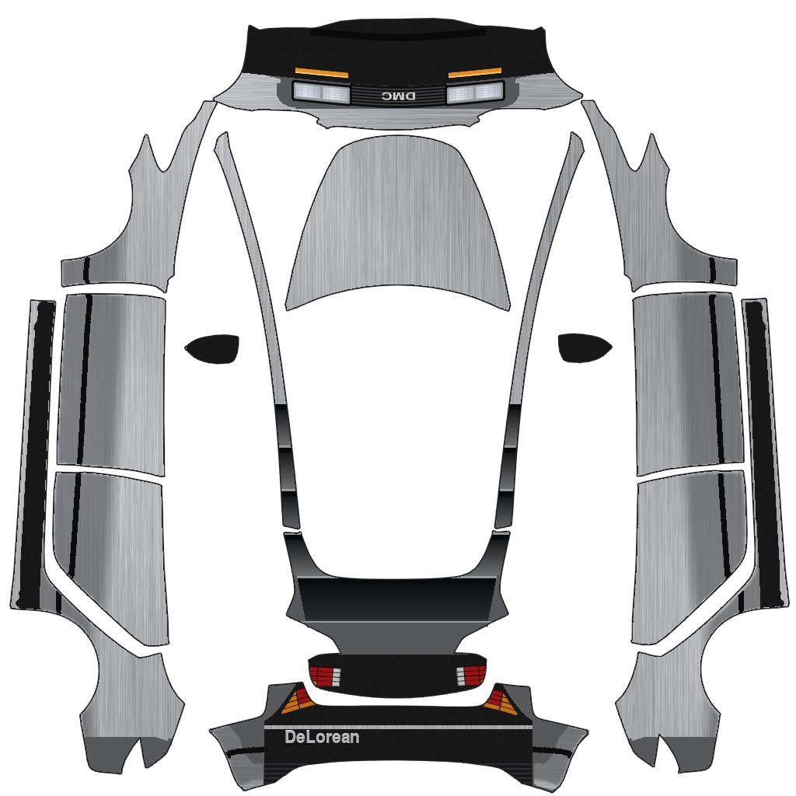

# Tesla Model 3 DeLorean Wrap

A custom Paint Shop wrap that turns the 2017–2023 Tesla Model 3 into a DeLorean DMC-12: brushed stainless steel body, black rear louvers, DMC grille with dual headlamps, DMC-style grid tail lights and a black bumper with DeLorean lettering.

## Download

**[DeLorean.png](DeLorean.png)**: 1024×1024 PNG, 258 KB, made on Tesla's official Model 3 (2017–2023) template.

It's for the original Model 3. The 2024+ Model 3 uses a different template, so this wrap won't line up on it.

## Install

1. Copy `DeLorean.png` to your car in one of two ways:
   * **Tesla app** (v4.59.0 or later): Creations → Wrap → Upload
   * **USB drive**: format it as exFAT or FAT32, create a folder named `Wraps` at the top level, and put the PNG in it. Leave any map or firmware update files off the drive.
2. In the car, go to **Toybox → Paint Shop → Wraps** and select **DeLorean**.
3. Optional: the plate area is blank so you can show your plate on top of the wrap in the app.

## Renders

| | |
|---|---|
|  |  |
| Front left | Front right |
|  |  |
| Left side | Right side |
|  |  |
| Rear left | Rear right |
|  |  |
| Rear | Front, low |

### Wrap layout

The flat file as Paint Shop sees it. The front of the car is at the top, so the front details are upside down in the file.

## Design details

* **Body:** brushed stainless steel, with the grain running front to back on the sides, hood and front corners.
* **Front:** a dark-grey surround with a black slatted grille, a small DMC badge and two pairs of rectangular headlamps in black outlines. Below them is a black bumper with amber indicators that wraps round the corners, and a black ground effect along the bottom.
* **Sides:** a level body crease line runs from the front fender to the rear bumper corner, with a darker band around it. The sill between the wheels is black.
* **Rear:** five deep black louvers run from the roof rails down to the trunk lid. Below them is a grey face between the Tesla tail lights, with a crease line at the turn-down. DMC-style grid tail lights have angled amber edges and white reversing lenses. The rear cowling is grey, and a black bumper with a stainless line carries **DeLorean** lettering.

The tail lights, louver edges and side stripe were placed by mapping Tesla's 3D model back to the wrap file, so they sit level and straight on the car rather than following the file's distortion.

## Credits

* **3D preview and renders:** [Wrap Check](https://github.com/tyleraspencer/wrap-check) by Tyler Spencer ([live viewer](https://tyleraspencer.github.io/wrap-check/?car=model3)). Every render here comes from Wrap Check, which runs Tesla's in-car visualizer and car models in the browser. In its own credits, Wrap Check says its engine and car meshes come from the open-source Tesla Wrap Studio project's build of Tesla's visualizer.
* **Wrap template:** Tesla's official [custom-wraps](https://github.com/teslamotors/custom-wraps) repository.
* **Design:** [@jmanis2](https://github.com/jmanis2), made with Claude.

DeLorean and DMC are trademarks of their respective owners. This is a fan-made visual skin for the in-car visualization only, and isn't affiliated with or endorsed by Tesla or the DeLorean Motor Company.
